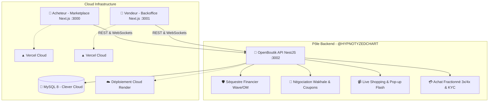

<p align="center">
  
</p>

<h1 align="center">🦁 OpenBoutik — Moteur E-Commerce & Marketplace Sécurisée</h1>

<p align="center">
  <b>Plateforme E-Commerce multi-vendeurs avec Séquestre Financier Garanti, Négociation en direct (« Wakhale »), Live Shopping temps réel et Paiement Fractionné (BNPL 3x/4x).</b>
</p>

<p align="center">
  <!-- Backend Core Stack -->
  <a href="https://nestjs.com/"></a>
  <a href="https://www.typescriptlang.org/"></a>
  <a href="https://developer.mozilla.org/fr/docs/Web/JavaScript"></a>
  <a href="https://nodejs.org/"></a>
  <a href="https://www.prisma.io/"></a>
  <a href="https://www.mysql.com/"></a>
  <a href="https://socket.io/"></a>
</p>

<p align="center">
  <!-- Frontend Stack (Marketplace & Seller Hub) -->
  <a href="https://nextjs.org/"></a>
  <a href="https://react.dev/"></a>
  <a href="https://developer.mozilla.org/fr/docs/Web/HTML"></a>
  <a href="https://developer.mozilla.org/fr/docs/Web/CSS"></a>
  <a href="https://tailwindcss.com/"></a>
  <a href="https://axios-http.com/"></a>
</p>

<p align="center">
  <!-- Cloud, Deployment & DevOps -->
  <a href="https://vercel.com/"></a>
  <a href="https://render.com/"></a>
  <a href="https://www.clever-cloud.com/"></a>
  <a href="https://jestjs.io/"></a>
  <a href="https://jwt.io/"></a>
  <a href="https://swagger.io/"></a>
</p>

---

## 👥 Équipe d'Ingénierie OpenBoutik

| Rôle | Développeur | GitHub | Dépôt Assigné & Périmètre |
| :--- | :--- | :--- | :--- |
| **Lead Backend Engineer (Dev 3)** | **Bécaye Doumbouya** | [@HYPNOTYZEDCHART](https://github.com/HYPNOTYZEDCHART) | [`openboutik-api`](https://github.com/OpenBoutik-Team/openboutik-api) — Core Engine, Séquestre, Wakhale, Live Shopping, BNPL, DB |
| **Lead Frontend Marketplace (Dev 1)** | **El hadji Mor** | [@akhy-m00](https://github.com/akhy-m00) | [`openboutik-marketplace`](https://github.com/OpenBoutik-Team/openboutik-marketplace) (Port 3000) — Tunnel Achat, Catalogue, Profil Client |
| **Lead Frontend Seller (Dev 2)** | **Mansour** | [@mansss7](https://github.com/mansss7) | [`openboutik-seller`](https://github.com/OpenBoutik-Team/openboutik-seller) (Port 3001) — Backoffice Marchand, Gestion Stocks, Analytics |

---

## 🏗️ Architecture Globale de l'Écosystème



---

## 🚀 Fonctionnalités Clés du Moteur Backend

### 1. 🛡️ Séquestre Financier Garanti (Escrow Engine)
* Verrouillage automatique des fonds lors du paiement client par Wave ou Orange Money.
* Rapprochement webhook sécurisé avec validation HMAC et idempotence stricte.
* Déblocage des gains sur le portefeuille marchand uniquement après confirmation de livraison ou expiration du délai de grâce.

### 2. 🤝 Le « Wakhale » Numérique (Négociation de Prix)
* Workflow bilatéral asynchrone Acheteur ↔ Vendeur.
* Statuts gérés : `PROPOSED`, `ACCEPTED`, `REJECTED`, `COUNTERED`, `EXPIRED`.
* Génération atomique d'un code promo privé à usage unique (remise exclusive) dès validation de l'accord.

### 3. 📹 Live Shopping & Vidéos Courtes
* Sessions de streaming interactif et flux de vidéos courtes (format Reels/TikTok).
* Gateway WebSockets temps réel sur le namespace dédié `/streams`.
* Épinglage flash de produits en direct avec pop-up d'achat instantané.

### 4. 💳 Paiement Fractionné BNPL (Buy Now Pay Later)
* Échéanciers 3x et 4x calculés à l'entier strict (zéro perte de centimes FCFA).
* Garde-fou KYC Acheteur obligatoire (validation carte d'identité / passeport).
* Cron automatisé quotidien (`@Cron(CronExpression.EVERY_DAY_AT_MIDNIGHT)`) pour le suivi des impayés et pénalités.

---

## 📦 Installation & Démarrage Rapide

```bash
# 1. Cloner le projet
git clone https://github.com/OpenBoutik-Team/openboutik-api.git
cd openboutik-api

# 2. Installer les dépendances
npm install

# 3. Générer le client Prisma
npm run prisma:generate

# 4. Lancer en local
npm run start:dev
```

---

## 🧪 Tests & Assurance Qualité

```bash
# Tests unitaires
npm run test

# Tests d'intégration End-to-End
npm run test:e2e

# Tests de stress et de concurrence
npm run test:stress

# Tests de résilience Chaos Monkey
npm run test:chaos

# Audit de sécurité & Pentest OWASP
npm run test:pentest
```

---

## 📄 Licence

Ce projet est la propriété exclusive de l'équipe **OpenBoutik**. Tous droits réservés.
